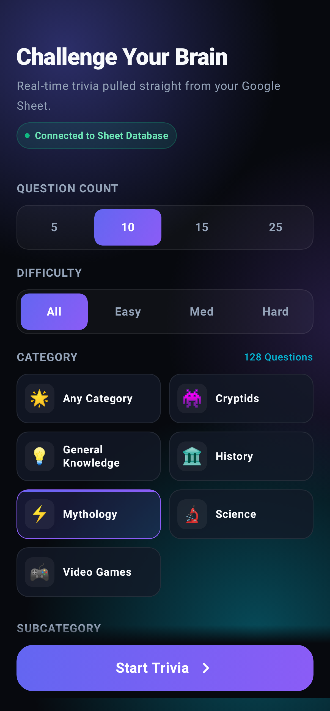
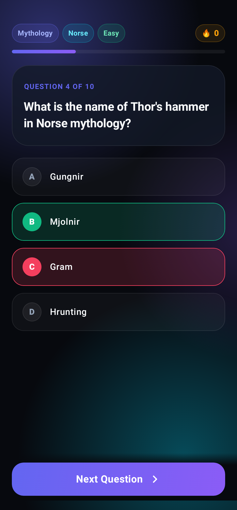
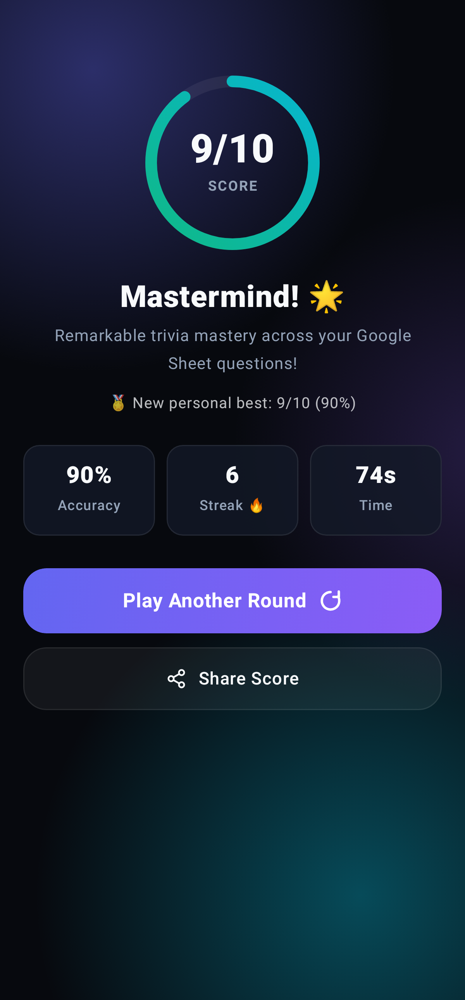

# QuizPulse for Android

A native Android version of QuizPulse, built with Kotlin and Jetpack Compose. It reads questions from the same Google Sheet as the web app.

<p>
  
  
  
</p>

## Features (same as the web app)

- Live questions from the Google Sheet (gviz JSON endpoint), with category and subcategory chips built from the sheet
- Filters for question count, difficulty, category and subcategory, saved between launches
- Sound effects synthesized on the device (the same tones as the web app's WebAudio cues), with a mute toggle
- Vibration feedback for taps and for correct, wrong and finished answers
- Streak counter, progress bar, shake animation on a wrong answer, and reveal of the correct answer
- Results screen with an animated score ring, stats, personal best, a confetti burst at 80% or higher, and sharing through the Android share sheet
- Pressing back during a round asks before quitting

## Build

Requirements: JDK 17+ and the Android SDK (platform 35).

```bash
cd android
./gradlew assembleDebug          # app/build/outputs/apk/debug/app-debug.apk
./gradlew installDebug           # install on a connected device or emulator
./gradlew testDebugUnitTest      # parser/filter unit tests
```

You can also open the `android/` folder in Android Studio and click Run.

To build a release, run `./gradlew assembleRelease`. It produces an unsigned, R8-minified APK. Add a `signingConfig` before you publish it.

### Screenshot previews

`ScreenshotTest` renders each screen on the JVM with Robolectric:

```bash
./gradlew testDebugUnitTest -Dscreenshots.dir=/path/to/out
```

## Layout

```
app/src/main/java/com/quizpulse/app/
├── MainActivity.kt        # edge-to-edge host, header, screen switching, back handling
├── QuizViewModel.kt       # all game state & logic
├── data/                  # Sheet fetch/parse, filters, SharedPreferences
├── fx/                    # SoundEngine (AudioTrack synth), Haptics
└── ui/                    # Compose screens, components, confetti, theme
```

The spreadsheet ID is set in `data/Models.kt` (`Config.SPREADSHEET_ID`).
